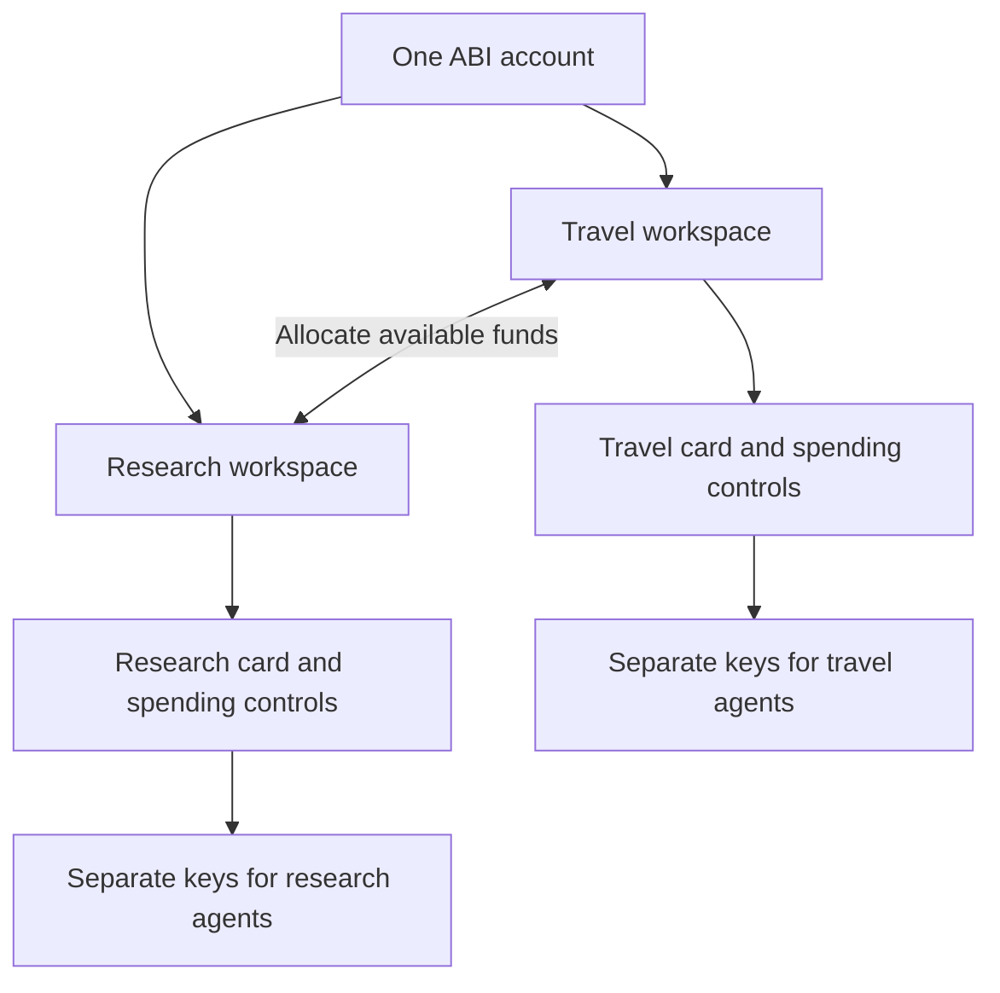

# Account, workspaces, cards and connections — implementation plan

Status: proposed implementation, not shipped. Reviewed 9 November 2026 against released commit `b8da26425f135a829107be7299f8763e1f573bb9`. This plan incorporates the confirmed choices: one account for buying and selling; multiple agents per workspace, with separate revocable keys sharing the workspace card’s budget.

## Product model

One account signs in once and owns or is invited to workspaces. Each workspace automatically receives one current ABI card, an isolated balance and its own spending controls. Its card can have multiple agent connections; each connection has its own credential. All those agents draw from the same workspace funds and shared card limits. An agent does not own a separate balance.

The card is ABI’s workspace spending identity, retaining the approved liquid-glass presentation. This proposal does not add payment-network card issuance or imply that a new workspace necessarily has a separate on-chain address.

## Audit findings

| Area                | Current evidence                                                                                                                                             | Required change                                                                                                                                                       |
| ------------------- | ------------------------------------------------------------------------------------------------------------------------------------------------------------ | --------------------------------------------------------------------------------------------------------------------------------------------------------------------- |
| Identity            | `store.ts` has `users`, `memberships` and a separate `partner_accounts` seller realm.                                                                        | Canonical human identity and session across buyer/seller experiences, with verified legacy-account linking.                                                           |
| Workspace selection | `/v1/auth/me` lists org memberships; `login-view.tsx` selects `orgs[0]` in several paths.                                                                    | Explicit workspace selection and validated last-used workspace; never silently switch someone into the wrong context.                                                 |
| Card                | `liquid-wallet-card.tsx` receives a name/network; Overview renders a card for the selected org.                                                              | Persist a real workspace/card relationship, lifecycle and budget association.                                                                                         |
| Creation            | Signup creates an org and vault; the public org-creation route is deliberately gated.                                                                        | Authenticated, idempotent workspace creation that creates its card and zero-funded accounting atomically. Do not reopen public org creation.                          |
| Credentials         | `session_keys` binds `org_id` and `agent_id`; Connect creates a key for an existing agent.                                                                   | Bind every new credential to workspace, card and agent connection; derive funding scope from that binding.                                                            |
| Funding             | `engine.ts:agentFundingContext` resolves an agent’s assigned department-budget accounts.                                                                     | Introduce an authoritative workspace funding resolver; preserve legacy assignments until migration is explicit and unambiguous.                                       |
| Allocation          | Wallet/Treasury use org, department and shared scopes inside one financial tenant.                                                                           | Present source workspace → destination workspace, backed by existing balanced ledger movements where appropriate.                                                     |
| Agent connection    | Connect exposes setup instructions and keys; remote MCP is an explicitly testnet-only proof path.                                                            | Verified handshake, capability discovery and lifecycle diagnostics for supported transports/clients. Key creation or copying instructions is not proof of connection. |
| Service connection  | `connections-panel.tsx` treats an allowlisted endpoint as connected and pins its payee. New service listing authentication/methods are descriptive metadata. | Distinguish permission to use a service from authenticated, tested provider access and supported invocation.                                                          |

These are workflow and architecture findings; this pass does not claim a demonstrated cross-account security exploit.

## End-to-end experience

1. **Sign in or create the account.** Use one identity. Create one empty General workspace for a genuinely new account; accepting an invitation must not duplicate an owned workspace. Buyer and seller tools use the same session.
2. **Create a workspace.** Give it a name and purpose. Create the workspace, exactly one card, funding binding and initial spending policy in one transaction. Retrying the same request returns the original result. No API key is generated automatically and no opening balance is invented.
3. **Set its spending controls.** Explain balance, budget limit, spent, held and remaining capacity separately. Keep current supported limit periods and retention constraints until durable counters justify extending them. Payment authority is explicit; an unset limit is not silently unlimited.
4. **Fund it.** Receive supported funds or allocate settled available funds from another owned workspace. If only the existing account vault has a verified receiving route, deposits initially credit its designated General workspace, then can be allocated. Do not invent separate deposit addresses.
5. **Connect an agent from its card.** Choose the workspace/card first, name the connection, select read/payment permissions and expiry, and issue a one-time credential. Agent identity/connection creation is part of this flow; users should not have to create a hidden funding group first.
6. **Verify the connection.** The actual agent client authenticates and performs a read-only probe. ABI confirms its workspace, card, scopes, current environment and spending capacity. The console records last successful verification. A separate, explicitly authorized test exercises purchase/approval behavior on the supported test network.
7. **Use ABI.** Marketplace purchases, service access, approvals, resources, history and seller activity retain the originating workspace/card/connection IDs. Switching the UI cannot redirect an in-flight order or refund.
8. **Manage the connection.** Revoke or rotate one key without disrupting other agents. Freeze the card to stop new spend across all its connections. Show expiry, revoked access, denied permissions, depleted balance and provider failures as distinct conditions.

## Account and workspace screens

- An account menu owns profile, sign-in security, sessions and sign-out. Workspace switching is always visible and includes Create workspace.
- Overview shows only the selected workspace’s card, available/held amounts and setup state. Account-wide totals, if shown, are clearly separate and count money once.
- Selecting the card opens its funds, limits and connections. Connect is already scoped to that card and offers both Setup and Keys, without an unrelated agent/budget prerequisite.
- Wallet’s main action becomes **Allocate between workspaces**: From, To, amount, asset/network, resulting balances and Review. Show approval/pending/completed receipts in both workspaces. Changing a budget limit does not transfer money.
- Billing separates card/workspace spending controls from any account-level subscription or USD-credit balance. USD credits never become USDC through a label change.
- Seller tools are a capability of an authorized workspace. Keep vendor identity, verification, listing ownership and payout associations explicit; unify login without merging legal business records or granting seller access automatically.
- Keep the current white/blue design and approved glass card. Navigation, dialogs, reloads, deep links, empty states and mobile layouts must carry the same active workspace context.

## Backend design

Keep login identity, authorization tenancy, workspace funding and credentials as separate concepts. Preserve existing `org_id` boundaries rather than blindly turning every org into a workspace or creating a new custody vault for every visual card.

Proposed records:

- `workspaces`: stable ID, tenant/owner references, name, status, default marker and immutable funding-account mapping.
- `workspace_cards`: stable ID, workspace ID, current lifecycle state and spending-policy reference. Enforce one current card per workspace; retain any historical version references.
- `agent_connections`: workspace ID, card ID, agent identity, transport/client metadata and verification state.
- Extend existing credential/session records with immutable workspace/card/connection bindings and revocation/expiry. Store hashes and masked identifiers; secrets are delivered once.
- `service_connections`: workspace/card owner context, provider/listing reference, verified endpoint identity, credential reference, granted resource/action scopes and last successful check. Provider secrets are encrypted and kept separate from ABI agent credentials.
- `workspace_allocations`: source and destination workspace, amount/asset/network, idempotency key, approval state and immutable ledger journal/receipt references.

Existing org/dept/shared accounts can back workspace funding bindings while their accounting history remains intact. A department budget is a possible backing implementation, not a second user-facing funding entity. The account’s existing org-available balance can back its General workspace. Agent labels are organizational metadata and must not automatically create duplicate workspaces or balances.

For authenticated browser requests, validate membership and the selected workspace server-side. For agents, derive workspace/card/funding context from the credential; body fields or headers cannot broaden it. Scope caches, pending requests and one-time secret display to workspace, clear them when switching, and reject stale-context mutations. Account ownership is not something an agent key inherits.

Illustrative API contracts, to finalize before implementation:

- Account workspace list/create and workspace read/update/archive.
- Card limits, connections and key create/rotate/revoke under the workspace.
- Agent context/capabilities probe derived from its credential.
- Workspace allocation create/status with a server-resolved source and destination.
- Provider connection authorize/verify/disconnect and narrowly scoped invocation.

Use explicit route context consistently, rather than mixing selected headers and body-selected funding IDs. Existing APIs receive a compatibility adapter until consumers migrate.

## Connection workstream — required functional behavior

There are two separate connections to verify: **agent → ABI** and **ABI/agent workflow → provider service**.

### Agent → ABI

Inventory REST, SDK, local MCP and hosted MCP code paths. Make each consume the same workspace/card credential resolver, permission checks, limits, approval handling and error contract. Close legacy-key paths that could bypass a frozen card or workspace restriction.

Support only transports that have been verified. Keep the current hosted developer endpoint labeled testnet-only until a reviewed production-capable transport/auth flow exists. Add OAuth authorization with consent, redirect validation, state and PKCE where a target client requires it; never merely remove the testnet guard. Prefer Authorization headers to credentials embedded in URLs, and redact all credential-bearing legacy paths.

Start a client verification matrix for Codex, Claude, Cursor, generic REST/SDK and compatible HTTP MCP. Record actual configuration, handshake, tool listing, context read, scoped action, expiry and revocation behavior. Logos or protocol compatibility do not establish that a named client was tested. Mark missing client access/provider configuration as unverified, not connected.

Connection states should reflect evidence: key created, verification needed, last verified, expired, revoked and error. Stateless HTTP/MCP should show a verification time rather than imply a continuously online socket. Policy-denied purchases do not mean the transport is broken.

### Provider/API service access

An allowlist entry means “permitted,” not “authenticated and operational.” A provider connection requires endpoint/payee verification, any required customer authorization, configured credentials and a successful capability check. Keep public data, customer data and customer-owned resource scopes distinct.

Do not forward an ABI credential to a vendor. Inject a provider credential only for its verified origin; encrypt it at rest and mask/redact it in responses, logs and diagnostics. Enforce the existing outbound URL protections and prevent redirect-based credential leakage.

Translate declared endpoint methods and request/response contracts into tested adapters. An API listing’s YAML does not by itself implement invocation. State-changing operations need explicit supported capabilities and approval controls; payment permission alone is insufficient. Keep unavailable write actions unavailable until implemented. Usage-based/monthly pricing remains descriptive until real metering, billing and reconciliation exist.

A connection test is read-only by default. Any purchase or write test is a separate reviewed action with an explicit amount/effect. On uncertain payment results, reconcile the existing order and idempotency key rather than paying again.

## Money and authorization invariants

- Balance is money; a spending limit is permission. Every agent on a card shares the remaining card limit. Creating a second key does not create a second budget.
- Remaining capacity is bounded by available funds, remaining card limits and any stricter account/connection/task rules. Reservations count before concurrent requests can authorize more spend.
- Workspace allocations move available funds, not held/escrowed amounts. They do not reset spending history or increase a recipient’s budget limit.
- Authorize both workspace contexts. Initially permit owner-controlled transfers among eligible workspaces in the same account, asset and network; agent keys have no account-wide reallocation authority.
- Use one atomic balanced journal and idempotent receipt for same-tenant internal movements. Do not fake an internal transfer across separate legacy custody/tenant boundaries; use a reviewed settlement path or block that pair until supported.
- Bind quotes, approvals, holds, settlements and refunds to their original workspace/card/funding account. Freezing access stops new authorization without losing reconciliation of already-broadcast payments.
- Existing ledger, custody, settlement and payment middleware remain the financial rails. Do not rewrite past journals, relabel testnet as mainnet or merge USD credits with USDC.

## Migration and rollout

1. **Inventory and contract.** Snapshot identities, memberships, funding units, agents, credentials, balances, policies, open orders and held funds. Agree the new API/error contracts and a per-record migration map.
2. **Identity and workspace model.** Add workspace/card/connection tables, uniqueness constraints and workspace-aware authorization. Link buyer/seller accounts only after appropriate proof of control; matching email alone is insufficient. Preserve stronger MFA and verified-email requirements.
3. **Backfill without moving money.** Map actual legacy funding units to workspace records and preserve existing ledger references. Reuse an existing unique budget for one workspace; do not create a workspace per overlapping group label. Ambiguous ownership or funding requires an explicit owner choice.
4. **Creation and UI.** Ship atomic create-workspace/create-card, workspace switcher, card detail and card-first key issuance. Add seller capabilities through the unified identity while retaining existing business records and access checks.
5. **Connection and spending enforcement.** Update every credential, REST/SDK/MCP path and provider connection to the same resolved workspace context. Preserve restrictive legacy bindings during transition; do not silently retarget an old token. New-workspace access requires a new explicitly scoped connection.
6. **Workspace allocation.** Route the new From/To UI through verified ledger bindings, approvals and receipts. Prove concurrent transfers and payments cannot overdraw or duplicate funds.
7. **Reconcile and retire legacy UI.** Compare balances, held amounts, receipts and permissions before/after. Retain old holds on original accounts until resolved. Remove Agent allowances/funding-group/dept/shared-wallet terminology from normal flows once mapped; preserve old identifiers in history/compatibility handling.
8. **Release gates.** Run integration tests and real supported-client checks in the configured test environment. Deploy only after reconciliation and isolation checks pass. Roll back application behavior without deleting migrated financial history or reviving revoked credentials.

## Acceptance scenarios

- Retried workspace creation yields one workspace and one card, with zero invented funds.
- Two agent keys share one Travel card budget; neither can read Research data or spend Research funds by changing a workspace/card ID.
- With an illustrative 100 USDC limit, simultaneous 75 USDC reservations cannot both authorize. More keys never multiply capacity.
- Moving 50 USDC between workspaces debits once, credits once, records both sides and leaves budget limits/history unchanged. Replays, self-transfers, insufficient funds and unauthorized destinations fail safely.
- Revoking one connection leaves other agents intact; freezing the card stops new spend for all of them across REST, SDK and MCP.
- Switching workspaces during a slow request, approval, purchase, seller save or refund never changes its originating context or flashes another workspace’s credentials/data.
- Unified sign-in preserves seller verification, listings, payouts, account security and membership roles. Revoked membership cannot be restored by a stale browser selection.
- A connector is considered verified only after an authenticated, correctly scoped call from the target client or provider adapter succeeds. Wrong credentials, missing scopes, expired keys and provider outages have distinct recoverable states.
- Unsupported methods, production transports, provider auth and monthly billing are clearly unavailable; setup instructions never substitute for a working integration.

Deliverables: migration/reconciliation report, agreed API contracts, updated screens, server authorization/funding resolver, client/provider verification matrix, regression tests and rollout/rollback evidence. No workspace/account migration or financial configuration change is performed by this planning document.
